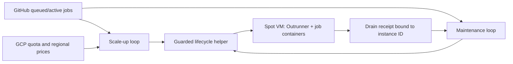

# also-ran

[](https://github.com/benandbalto/also-ran/actions/workflows/ci.yml)
[](LICENSE)

Self-hosted GitHub Actions runners on Google Cloud Spot VMs that scale with
your queue and are deleted only after the controller has verified that their
work is finished. It needs no Kubernetes.

> [!WARNING]
> **Experimental.** This repository was extracted from a single production
> deployment. Its offline regression suite passes, but the generalized
> install path has **not** yet been run in a fresh GCP project. Expect to read
> code, provision IAM yourself, and run your own regional acceptance before
> you enable any automatic creation or deletion.

## Why it exists

also-ran runs on one controller host using systemd timers. It combines
demand observation, quota admission and verified host retirement without
requiring a Kubernetes cluster:

- **Demand-driven Spot capacity.** It watches queued and running jobs for your
  repositories and creates C4 Spot VMs with local SSDs. It stays inside GCP
  quota, regional limits and price ceilings.
- **Verified scale-down.** The normal path cross-checks GitHub job and runner
  records against a guest drain receipt tied to the numeric instance ID, boot
  generation, slot and image commit. Recovery paths require separate
  admission-closure and continuous idle evidence. An API error or an
  incomplete page counts as *unknown*, never as *idle*.
- **Fresh container per job.** Each VM runs the pinned
  [Outrunner fork](https://github.com/ArborealMgmt/gha-outrunner), one job at a
  time, in a new Sysbox-isolated container. A VM handles a bounded number of
  jobs in sequence, then closes admission and is retired.

## How it works



1. A **scale-up** timer and a **maintenance** timer share one GitHub API
   budget and one mutation lock. You can run both as a single
   `gcp_reconciler.py` service instead, but not alongside the timers.
2. Hosts boot from a **credential-free golden image**. At boot each guest
   checks its project and instance metadata, fetches its runner credential
   from Secret Manager, mounts the local SSD for Docker and starts Outrunner.
3. When a host reaches its per-host job limit, or maintenance asks it to
   drain, the guest **persistently closes admission** (a reboot does not
   reopen it) and publishes a drain receipt. Maintenance cross-checks the
   receipt with GitHub, then deletes the host after checking its identity
   again.
4. Optional helpers record regional Spot prices and capacity, and estimate
   the cost of each run. These figures are estimates, not invoices.

More detail: [docs/architecture.md](docs/architecture.md).

## Is it a fit?

| | First release |
| --- | --- |
| Cloud | One dedicated GCP project with billing, Compute Engine, Secret Manager, Cloud Billing Catalog and Cloud Quotas APIs |
| GitHub | Repositories listed explicitly, all in one organization. The generated configuration registers organization-level runners. A GitHub App with read access for the controller, and a separate runner-management credential for Outrunner |
| Topology (fixed) | Heavy pool: up to 28 × `c4-standard-8-lssd`. General pool: up to 12 × `c4-standard-4-lssd`. Fixed regions and zones. Validators reject other machine families and region sets |
| Workflow labels (fixed) | `runs-on: outrunner-gcp-linux-x64` (heavy), `runs-on: outrunner-gcp-general-linux-x64` (general) |
| Controller host | Any Linux host with systemd, Python 3.12, OpenSSL and the Google Cloud CLI, managed with Ansible |
| Runner image | Ubuntu 24.04 x86-64, built by the included Ansible playbook |

Probably **not** a fit if you need:

- other clouds, ARM, GPUs, or arbitrary machine types;
- runners for repositories in several organizations;
- isolation for untrusted code, such as fork pull requests on a public
  repository. Containers isolate workloads, but they are not a boundary for
  hostile multitenancy.

At the generated ceilings the fleet can reach 28 × 8 + 12 × 4 = 272 C4 vCPUs.
Check your project's regional and global quotas before deployment. These
ceilings are limits, not reservations.

## Try it locally

This step is safe to copy and paste. It reads no credentials, calls no cloud
or GitHub API, and starts nothing.

Requirements: Linux, Git, Make, Python 3.12, Bash, `jq`, coreutils and procps. The
controller and core tests use only the Python standard library. Installing the
development requirements also enables systemd-template rendering checks.

```bash
git clone https://github.com/benandbalto/also-ran.git
cd also-ran
make check   # offline test suite, then validates the synthetic fixture policy
```

Then generate a configuration for your own project. This is offline too:

```bash
python3 scripts/configure.py \
  --project-id your-runner-project \
  --project-number 123456789012 \
  --resource-prefix your-team \
  --fleet your-team-ci \
  --github-repository your-org/your-repo \
  --image-source-commit "$(git rev-parse HEAD)" \
  --ssh-source-cidr 192.0.2.1/32 \
  --output-dir deployment.local

python3 scripts/validate-config.py \
  --deployment deployment.local/deployment.json \
  --policy deployment.local/gcp-policy.json \
  --bootstrap
```

- Replace `192.0.2.1/32` (a documentation address) with your administrators'
  real egress CIDR. `0.0.0.0/0` is rejected.
- Repeat `--github-repository` for each repository. All of them must belong to
  the same organization.
- The command refuses to overwrite an existing directory. To regenerate,
  choose another output path and compare the files with your existing
  configuration before replacing it.
- If you leave out `--bootstrap`, validation **fails on purpose** with
  `production region is not validated`. It keeps failing until you approve
  regions after acceptance testing.

Source-tree operator commands require `ALSO_RAN_DEPLOYMENT` to select your
trusted identity and an explicit `--policy` where applicable. They never
automatically use the synthetic test fixture. The deployment guide shows the
required environment setup.

The configuration is generated with creation, deletion and scheduling disabled:

| File | Contents | Starts as |
| --- | --- | --- |
| `deployment.json` | Trusted project ID and number, resource prefix, fleet label | — |
| `gcp-policy.json` | Images, service accounts, network, pools, regions, budgets | Every region `canary_valid: false`; both pools `demand_only` with `automatic_delete: false` |
| `image-vars.json` | Pinned Outrunner, runner image and bootstrap identity for the image build | Outrunner disabled on the builder; guest telemetry off |
| `controller-vars.json` | Source paths, credential paths, activation switches | Broker off; both `*_apply` switches `false` |

Hosts scale with demand by default. Use `--warm-pool` only if you want the
example schedule: 8 heavy and 4 general hosts from 08:00 to 23:00
`America/Los_Angeles`, every day, while demand has been seen in the last
60 minutes. The window opening counts as demand, so an activated fleet warms
even without jobs. Review this schedule and its cost before enabling creation.
Automatic deletion remains a separate switch and must be enabled after testing
for unattended scale-to-zero operation.

Guest telemetry is also opt-in: `--enable-telemetry` builds an image that sends
host metrics and journal events to Axiom and requires an ingest secret. Core
readiness and drain evidence work without it. All generated files are mode
`0600` in a `0700` directory and contain no credentials.

## Deploying

Deployment is an operator-run bootstrap, not a one-command installer. Every
cloud mutation needs an explicit `--apply`, or an Ansible run without
`--check`. Read [docs/deployment.md](docs/deployment.md) in full first. The
outline:

1. **Identities.** Create the four service accounts named in the policy
   (observer, controller, builder, runtime). Grant permissions under your own
   policy using the [per-account IAM permissions](docs/iam.md). Create the
   controller's read-only GitHub App and Outrunner's runner credential.
   Store guest secrets in Secret Manager.
2. **Network.** Create the VPC, the `us-central1` subnet, the SSH/IAP firewall
   rules, Cloud NAT, and the regional subnets.
   `scripts/gcp-region-foundation.py` plans the extra regions.
3. **Image.** Create a builder, run `runner-image-builder.yml` against it,
   then capture the image and delete the builder. All of this uses
   `scripts/gcp-runner-lifecycle.py`. The playbook targets only
   `image_builders` and erases SSH keys and cloud-init state during finalization.
   Put only disposable image builders in that inventory group.
4. **Acceptance.** Run held canaries in `northamerica-northeast1`,
   `europe-west9` and `us-south1`. Check boot, local-SSD Docker, a completed
   job, admission closure, drain receipt, Spot interruption and teardown.
   Only then set `canary_valid: true` for the regions you verified.
5. **Controller.** Run `also-ran.yml` with `--check --diff`, then without it.
   Enable the broker in observe-only mode and review its decisions. Then
   enable apply for **one pool at a time**. Enable `automatic_delete` only
   after the deletion path is tested.

Production validation is offline. It checks policy structure and approval
flags; it cannot check that your acceptance evidence is true.

### Things to know before you deploy

- **Controller authentication defaults to an attached GCP service account.**
  Controllers outside GCP can use Workload Identity Federation; explicit
  service-account keys remain a compatibility option. See
  [authentication](docs/authentication.md). Keep controller credentials away
  from runner jobs.
- **Axiom is optional.** Guest telemetry is disabled by default; enable it only
  with a scoped ingest secret. Journal logs and local readiness remain available.
- **The default job image follows the original deployment's toolchain**:
  Node, pnpm, a Postgres client, Docker-in-Docker, `gh`, Azure CLI, Bicep,
  Azure Functions tools, Azurite and Playwright. Review
  [`Dockerfile.also-ran`](ansible/roles/outrunner/files/Dockerfile.also-ran)
  before you build; [runner-image customization](docs/runner-image.md) explains
  the image contract and telemetry options.
- **Stopping a timer does not stop a pass that is already running.** Pause
  both timers, and the reconciler if you use it, before rollbacks or identity
  changes. See *Operation and rollback* in the deployment guide.

## Repository layout

| Path | What it is |
| --- | --- |
| `controller/also-ran/` | Controller: `gcp_broker.py` (admission, drain, deletion), `gcp_pools.py`, `gcp_reconciler.py`, `gcp_market_observer.py`, `gcp_run_telemetry.py`, `github_app_token.py`, shared primitives in `also_ran.py` |
| `controller/also-ran/tests/` | Offline unittest suite (controller, lifecycle, bootstrap shell, image) |
| `scripts/configure.py`, `scripts/validate-config.py` | Offline configuration generation and validation |
| `scripts/gcp-*.py` | Operator helpers for the lifecycle, region foundations and preflight (they call `gcloud`) |
| `ansible/` | Playbooks and roles for the controller host and the golden runner image |
| `examples/` | Placeholder inventory and image variables |
| `docs/` | [Architecture](docs/architecture.md) and [deployment](docs/deployment.md) |

[`legacy/`](legacy/README.md) holds the original Hetzner/Azure policies and
image lifecycle helpers for regression coverage. Shared observation primitives
remain in the controller. The standalone install path supports GCP only.

## Development

```bash
make test     # unit and shell tests only
make check    # tests + fixture policy validation

# Ansible syntax checks (CI runs these too; they contact no hosts)
python3 -m venv .venv
.venv/bin/pip install --require-hashes -r requirements-dev.txt
PATH="$PWD/.venv/bin:$PATH" make check
make ansible-check ANSIBLE_PLAYBOOK=.venv/bin/ansible-playbook
```

A mocked API result is not evidence of live acceptance. Example identities and
`canary_valid` flags in fixtures are test data.

## Contributing, security and license

- **Contributing:** open an issue first, then send a focused pull request with
  its validation. See [CONTRIBUTING.md](CONTRIBUTING.md) for the boundaries
  every change must keep and our [code of conduct](CODE_OF_CONDUCT.md).
- **Security:** report vulnerabilities privately, as described in
  [SECURITY.md](SECURITY.md). Do not open a public issue.
- **Releases:** [CHANGELOG.md](CHANGELOG.md) records prereleases and known limits.
- **License:** [Apache-2.0](LICENSE). See [NOTICE](NOTICE) for attribution.
  Outrunner is a separate MIT-licensed download and is not relicensed here.
