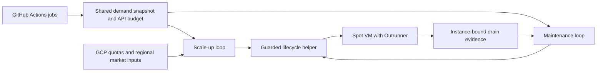

# Architecture

also-ran separates demand observation, capacity admission, guest lifecycle, and
deletion verification. Provider errors and incomplete observations are unknown
state, never evidence that a host is idle.

## Controller

`controller/also-ran/also_ran.py` provides shared HTTP, GitHub observation,
locking, pagination, and atomic state primitives. `gcp_broker.py` admits creation,
tracks drain decisions, verifies evidence, and records JSON state and journal
events. `gcp_pools.py` runs heavy and general pools independently.

The scale-up loop fills absent slots. Maintenance requests drains and performs
identity-checked deletions. A shared mutation lock and live cross-pool quota
reads constrain concurrent operations. The optional `gcp_reconciler.py` owns
these tasks in one service; the Ansible role prevents enabling it alongside
the two broker timers.

`gcp_market_observer.py` supplies read-only regional capacity and pricing
observations. `gcp_run_telemetry.py` joins workflow and host generations to
produce modeled per-run costs. Modeled costs are not a cloud invoice. The
optional fleet report can read billing exports and Axiom evidence when given
explicit environment configuration.

## Trusted identity and policy

`deployment_identity.py` loads a separate, root-owned deployment identity.
`ALSO_RAN_DEPLOYMENT` is required to select its file for source-tree commands; installed
services use `/opt/also-ran/deployment.json`. The GCP project ID and number,
resource prefix, and fleet label are validated before runtime policy is accepted.
A changed project ID in the policy cannot redirect the lifecycle helper to
another project.

The policy pins image provenance, exact host names, labels, slots, machine and
disk shapes, network boundaries, and capacity ceilings. Installation files are
root-owned. Configure them through an administrator-controlled deployment;
neither a job nor an untrusted pull request may write them.

The runtime accepts a bounded list of explicit full Git commits for legacy
images during image migration. New installations start with an empty list.
Only add commits for images that actually have running hosts to drain, and
remove them after the last host is gone.

## Guests and deletion

The image contains the pinned Outrunner binary, a job container image, and GCP
bootstrap/reaper scripts. It contains no runtime credentials. At boot, a guest
checks project and instance metadata, fetches its runtime secrets, mounts local
SSD, and starts its one-job-at-a-time runner service.

Receipts bind completed work to the numeric GCP instance ID, boot generation,
scale set, slot, and image provenance. Maintenance cross-checks GitHub work and
runner registration before acting. Recovery paths additionally require their
own admission-closure and continuous idle evidence; elapsed time alone is not
sufficient. The lifecycle helper checks identity again at deletion.

The guest persists an admission-closed marker before publishing its
acknowledgement. Service start guards consume that marker, so reboot cannot
silently reopen admission. Shared systemd runtime directories use
`RuntimeDirectoryPreserve=yes` so one finished service cannot remove another
loop's locks.

Containers are workload isolation, not a guarantee for hostile multitenancy.
Deploy runner credentials and network access according to the trust level of
the workflows you allow onto the fleet.
